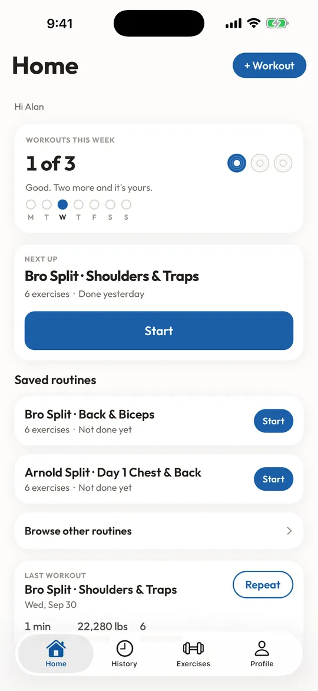
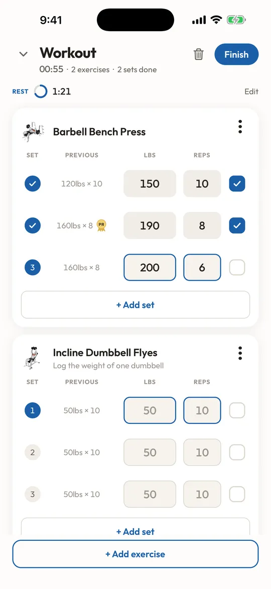
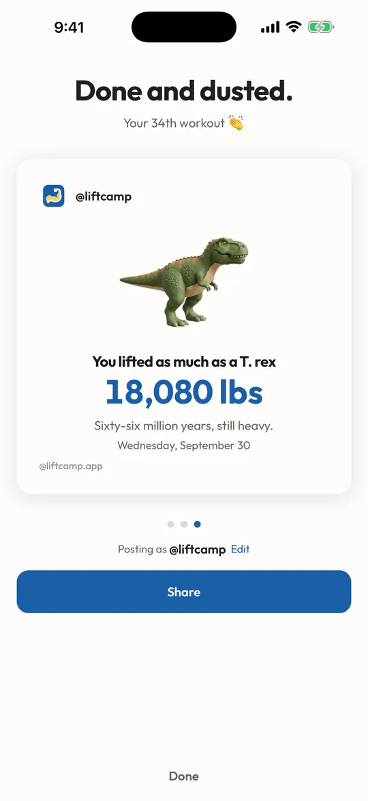
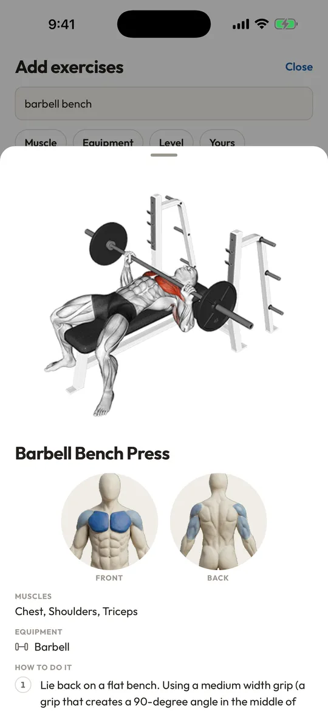
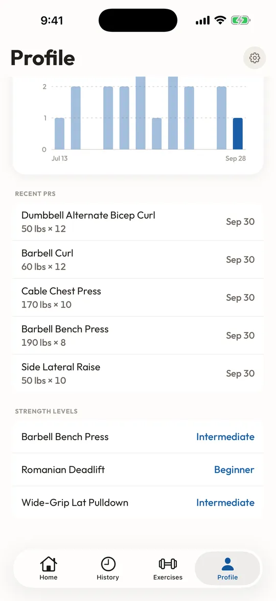

# LiftCamp

A strength training app for people in their first 6 months of lifting. It picks a starter program, makes logging a set one tap, and keeps you coming back with a weekly streak.

[App Store](https://apps.apple.com/app/liftcamp/id6815821010) · [liftcamp.app](https://liftcamp.app)

<p>
  
  
  
  
  
</p>

## Who built it

I'm Alan Harris, a growth and lifecycle marketer (Segment, Retool, TLDR). I'm not a software engineer. I built LiftCamp with AI coding tools to see how far a marketer could take a real product, and to have a lifting app I'd recommend to a friend who just joined a gym.

The history shows how that went. The first version came from a single prompt in Lovable in June 2026 (it's saved in [docs/original-lovable-prompt.md](docs/original-lovable-prompt.md)). In September I moved the code to GitHub, Vercel, and my own Supabase project, and since then I've built it with Claude Code. That's about 2,000 commits, 65 database migrations, and an iOS app that went through App Store review in October.

## How I work with Claude Code

- **[CLAUDE.md](CLAUDE.md)** is the project's memory. It holds the schema facts, deploy traps, and conventions that cost me real time to learn, so each session starts from them instead of rediscovering them.
- **Specs before code.** Most features start as a written spec in [docs/](docs/) (27 of them), covering the user problem, the screens, and the edge cases. Claude builds from the spec, and I review against it.
- **One branch per feature,** each in its own worktree. Claude verifies with typecheck and tests, I test in the simulator, and then it merges.

## What it does

- **Programs that fit.** A short onboarding picks a starter program by training days, experience, and equipment. Intermediate splits like PHUL and Push/Pull/Legs are there too.
- **Fast logging.** Last session's numbers show in every row. A rest timer runs between sets. Workouts can be started, logged, and finished offline, then sync later.
- **Try before signing up.** Guests get a real anonymous account, so the first workout works with no sign-up. Signing in with Apple, Google, or email later merges that guest data into the new account.
- **850+ exercises** with instructions, a muscle diagram, and beginner notes on starting weight, form, and substitutions.
- **Progress.** PRs flagged as they happen, per-exercise charts, and strength levels for the big four lifts.
- **Weekly streak.** Pick a target of 2 to 6 days a week. Four weeks in a row banks a rest week.

## Decisions worth explaining

**Weight is free text.** People log "40 (x2)" for a pair of dumbbells or "Body weight (-100)" for an assisted machine. Forcing a number field would break the fastest path through the app, so the raw text is kept and a separate numeric column is derived from it for charts.

**Each set keeps its own unit.** Switching from lb to kg converts the display, never the stored data, so old workouts stay exactly as logged.

**Row-level security on every table.** All access is scoped to `auth.uid()`, including anonymous guests, so guest mode needed no special policies.

**Leaving Lovable.** Lovable got the first version running fast. Once I needed a mobile app, my own auth setup, and control over the database, I moved everything to infrastructure I own. The migration plan and its gotchas are in CLAUDE.md.

**Licensed exercise media.** Demo animations are licensed from ExerciseDB, and the license terms decided where they can appear. A lot of the exercise art is original, drawn in a consistent clay style around the app's mascot.

**SEO as the acquisition channel.** The website is a public exercise library, routine guides, a plate calculator, and strength standards by lift. Each page targets a search a new lifter actually makes.

**An MCP server.** LiftCamp's catalog is available to AI assistants at [liftcamp.app/mcp](https://liftcamp.app/mcp). It has 4 tools: exercise guides, exercise swaps, routine finder, and strength level. A beginner asking ChatGPT or Claude for a workout can get a LiftCamp routine back with a link to start it.

**Retention before revenue.** The [roadmap](docs/roadmap.md) keeps logging, history, and every starter program free forever, and holds paid features until retention numbers say people are sticking.

## Stack

| | |
|---|---|
| Mobile | Expo (React Native), iOS live, Android in progress |
| Web | TanStack Start, Tailwind, deployed on Vercel |
| Backend | Supabase (Postgres, Auth, Storage, Edge Functions) |
| Email | Resend |
| Repo | pnpm monorepo |

```
apps/mobile      Expo app for iOS and Android
apps/web         liftcamp.app: public site, guides, admin, MCP server
packages/shared  Types, Supabase client, and logic both apps use
supabase/        Migrations and edge functions
docs/            Feature specs, SQL notes, roadmap
```

## License

All rights reserved. The code is public so people can see how it was built. Please don't reuse it in another app.
